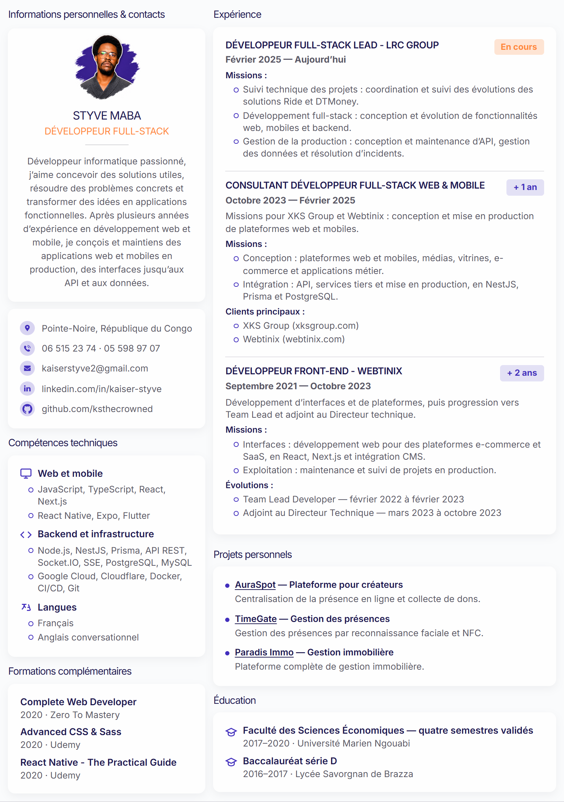

# Styve Maba — CV

CV HTML/CSS statique, multilingue, avec une variante par candidature. Le contenu vit dans des fichiers JSON ; la page les charge et les affiche.



## Prévisualisation

Le JSON ne se charge pas en ouvrant `index.html` directement (`file://`). Il faut un serveur local.

```bash
npx serve .
```

Puis ouvrir [http://localhost:3000](http://localhost:3000).

Avec Bun :

```bash
bun run preview
```

| URL | Rendu |
|-----|--------|
| `/?variant=default&lang=fr` | Français, variante par défaut |
| `/?variant=default&lang=en` | Anglais |
| `/?variant=<slug>&lang=<code>` | Autre variante et langue |

La barre en haut de la page change le poste, la langue, et le rognage A4 (mémorisé dans `localStorage`).

## Contenu

| Modifier | Fichier |
|----------|---------|
| Texte du CV (toutes les langues) | `data/variants/<slug>.json` → `locales.fr`, `locales.en`, … |
| Libellés d’interface | `data/i18n/fr.json`, `data/i18n/en.json` |
| Variante affichée par défaut | `data/variants/default.json` |
| Liste des variantes | `data/variants/manifest.json` |
| Coquille HTML | `index.html` |
| Couleurs et police | `css/tokens.css` |
| Mise en page | `css/layout.css` |
| Impression A4 | `css/print.css` |

Chaque variante déclare `meta.defaultLocale` et `meta.availableLocales`. Le texte traduit est dans `locales.<code>` ; les titres de section partagés sont dans `data/i18n/<code>.json`.

Pour une nouvelle variante : dupliquer `data/variants/default.json` vers `data/variants/<slug>.json`, puis ajouter une entrée dans `data/variants/manifest.json`.

Une mission s’ajoute dans le tableau `missions` de l’expérience concernée, au format `Thème : description`.

Le portrait est `assets/pp-kaiser.png`.

## Export PDF

L’export automatique utilise Playwright et nécessite Chrome installé.

Terminal 1, serveur de preview :

```bash
bun run preview
```

Terminal 2, toutes les variantes et langues listées dans `data/variants/manifest.json` :

```bash
bun run export:pdf
```

Les PDF sont écrits dans `exports/<variante>/<langue>/`.

Une seule combinaison :

```bash
CV_VARIANT=default CV_LANG=en bun run export:pdf:single
```

| Variable | Défaut | Rôle |
|----------|--------|------|
| `CV_VARIANT` | `default` | Slug (`data/variants/<slug>.json`) |
| `CV_LANG` | `fr` | Code langue |
| `CV_OUT` | `exports/<variant>/<lang>/Styve Maba - CV.pdf` | Fichier de sortie |
| `CV_BASE_URL` | `http://localhost:3000` | URL du serveur de preview |

Export depuis le navigateur : ouvrir la variante voulue, Ctrl+P, destination **Enregistrer en PDF**, marges **Aucune**, échelle **100 %**, **Graphiques d’arrière-plan** cochés.

## Structure

```
index.html                   coquille HTML
data/i18n/                   libellés d’interface
data/variants/               contenu par variante et par langue
data/variants/manifest.json  index des variantes
css/                         tokens, mise en page, impression
js/render.js                 injection du JSON (?variant= & ?lang=)
assets/                      portrait, icônes, polices
exports/                     PDF générés
lettres/                     lettres de motivation (HTML)
scripts/                     export PDF
```

## Couleurs

| Token | Valeur | Usage |
|-------|--------|--------|
| `--color-primary` | `#1e1950` | Titres, nom |
| `--color-accent` | `#422fbd` | Sections, icônes |
| `--color-orange` | `#ff893a` | Titre sous le nom |
| `--color-text` | `#585665` | Corps de texte |
| `--font-family` | Inter | Police |
